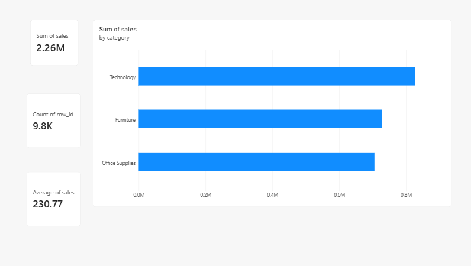

# Superstore Sales Analytics (SQL + Power BI)

End-to-end sales analysis project using the **Superstore Sales** dataset (9,800 records). Data was queried and analyzed in **MySQL** and visualized in an interactive **Power BI Desktop** dashboard.

## Tools & Stack
- **Database & Querying:** MySQL (port 3307), SQL (`superstore_db.ventas`)
- **Visualization:** Power BI Desktop

## Key Metrics & Insights
- **Total Sales:** `2.26M` across `9,800` records, with an average order/line sale of `230.77`.
- **Category Performance:** **Technology** leads total revenue, followed by **Furniture** and **Office Supplies**.

## Dashboard Preview

## Project Files
- `analisis_superstore.sql`: SQL queries for data exploration and sales analysis.
- `dashboard_superstore.pbix`: Interactive Power BI report connected to `superstore_db.ventas`.
- `dashboard_preview.png`: Snapshot of the dashboard KPIs and category breakdown.
